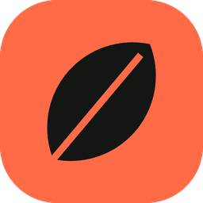
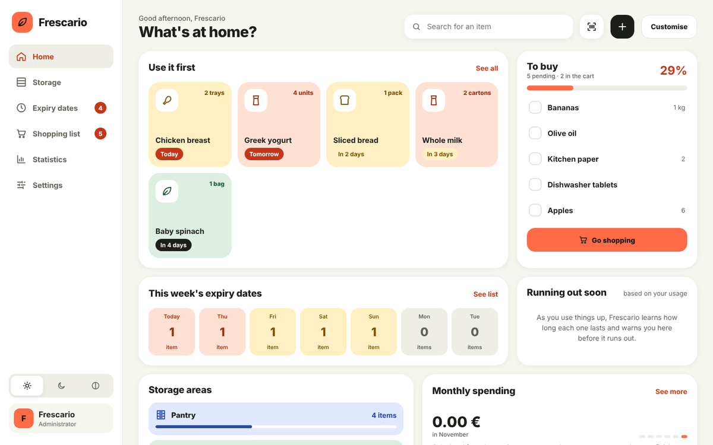
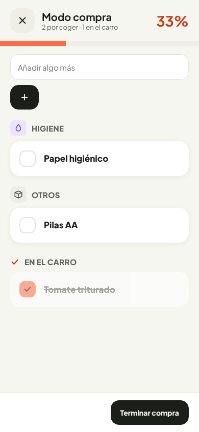
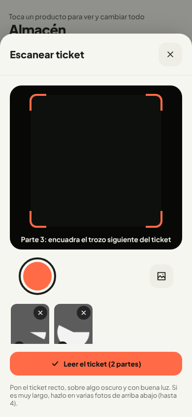

<p align="center">
  
</p>

<h1 align="center">Frescario</h1>

<p align="center">
  <b>Your home pantry, fridge, freezer and shopping list, inside Home Assistant.</b><br>
  <i>La despensa, la nevera, el congelador y la lista de la compra de casa, dentro de Home Assistant.</i>
</p>

<p align="center">
  <a href="https://my.home-assistant.io/redirect/supervisor_add_addon_repository/?repository_url=https%3A%2F%2Fgithub.com%2Fomorlabs%2Ffrescario"></a>
</p>

<p align="center">
  
  
  
</p>

<p align="center">
  
</p>

---

**English** · [Castellano](#castellano)

## What it does

Frescario is a Home Assistant app (formerly called add-on) that keeps track of everything you have at home and tells you what to use first, what is running out and what to buy.

- **Expiry dates that actually work.** A daily notification to your phone: *"Today: chicken breast. Tomorrow: plain yogurt."* You choose the time and how many days ahead.
- **Live barcode scanner.** Point your phone camera at a product: name, photo and category are filled in from Open Food Facts.
- **Live receipt scanner.** Take a photo of your supermarket receipt (long ones in several parts) and the whole shopping trip goes into your pantry, with prices. Uses Google Gemini with your own key.
- **Smart shopping list.** Grouped by aisle, full-screen shopping mode with big tap targets, works without signal inside the shop and syncs when you are back online.
- **Voice.** Syncs both ways with a Home Assistant to-do list, so "add milk to the shopping list" works with Assist.
- **Consumption forecast.** Learns how fast you use things and warns you before they run out.
- **Prices and statistics.** Price per supermarket for each product, monthly spending, what you consume most and what ends up in the bin.
- **For the whole family.** Every Home Assistant user gets their own profile: light or dark theme, accent colour, their own customisable home screen and their own notifications. Admin, family or read-only permissions.
- **Real Home Assistant integration.** Sensors such as `sensor.frescario_caducan_hoy` or `sensor.frescario_bajo_minimo` for your dashboards and automations.
- **Responsive.** Designed for phone, tablet and desktop.

Available in **English** and **Spanish**: each person picks their language in Settings. Want Frescario in your language? Translations are a single file, see [CONTRIBUTING.md](CONTRIBUTING.md).

<p align="center">
  
  &nbsp;
  
</p>

## Installation

1. Click the **Add repository** button above, or in Home Assistant go to **Settings → Apps → App store → ⋮ → Repositories** and add `https://github.com/omorlabs/frescario`.
2. Find **Frescario** in the store and click **Install**.
3. Turn on **Start on boot** and **Show in sidebar**, then **Start**.
4. Open Frescario from the sidebar. The first person to open it becomes the administrator.

To use the camera (barcodes and receipts), open Home Assistant through its **HTTPS** address.

## Configuration

```yaml
administradores:
  - your_ha_username       # optional, Frescario admins
lista_ha: todo.shopping_list  # optional, to-do list synced for voice
gemini_api_key: ""          # optional, Google Gemini key to read receipts
```

All data stays inside your Home Assistant and is included in its regular backups.

## Contributing

Bug reports, ideas, translations and pull requests are welcome. Read [CONTRIBUTING.md](CONTRIBUTING.md) to get started.

## Support the project

Frescario is free and will stay free. If it saves you time and food, you can support its development.

<a href="https://ko-fi.com/frescario"></a>

---

<a name="castellano"></a>

## Castellano

Frescario es una app de Home Assistant que lleva la cuenta de todo lo que hay en casa y te dice qué gastar primero, qué se está acabando y qué hay que comprar.

- **Avisos de caducidad** al móvil cada día, a la hora que elijas.
- **Escáner de códigos de barras** en directo, con nombre, foto y categoría automáticos.
- **Escáner de tickets** en directo, también por partes, que mete toda la compra en el almacén con sus precios.
- **Lista de la compra** por pasillos, modo compra a pantalla completa y uso sin cobertura en el súper.
- **Voz**, sincronizada con una lista de tareas de Home Assistant.
- **Previsión de consumo**, precios por supermercado y estadísticas.
- **Para toda la familia**, cada uno con su tema, su inicio y sus avisos, y con permisos.
- **Sensores** en Home Assistant para paneles y automatizaciones.

### Instalación

1. Pulsa el botón **Add repository** de arriba, o en Home Assistant ve a **Ajustes → Apps → Tienda de apps → ⋮ → Repositorios** y añade `https://github.com/omorlabs/frescario`.
2. Busca **Frescario** en la tienda y pulsa **Instalar**.
3. Activa **Iniciar al arrancar** y **Mostrar en la barra lateral**, y pulsa **Iniciar**.

¿Quieres colaborar? Mira [CONTRIBUTING.md](CONTRIBUTING.md). Y si Frescario te ahorra tiempo y comida, puedes [invitarme a un café en Ko-fi](https://ko-fi.com/frescario).

## License

[MIT](LICENSE) © 2026 omorlabs
